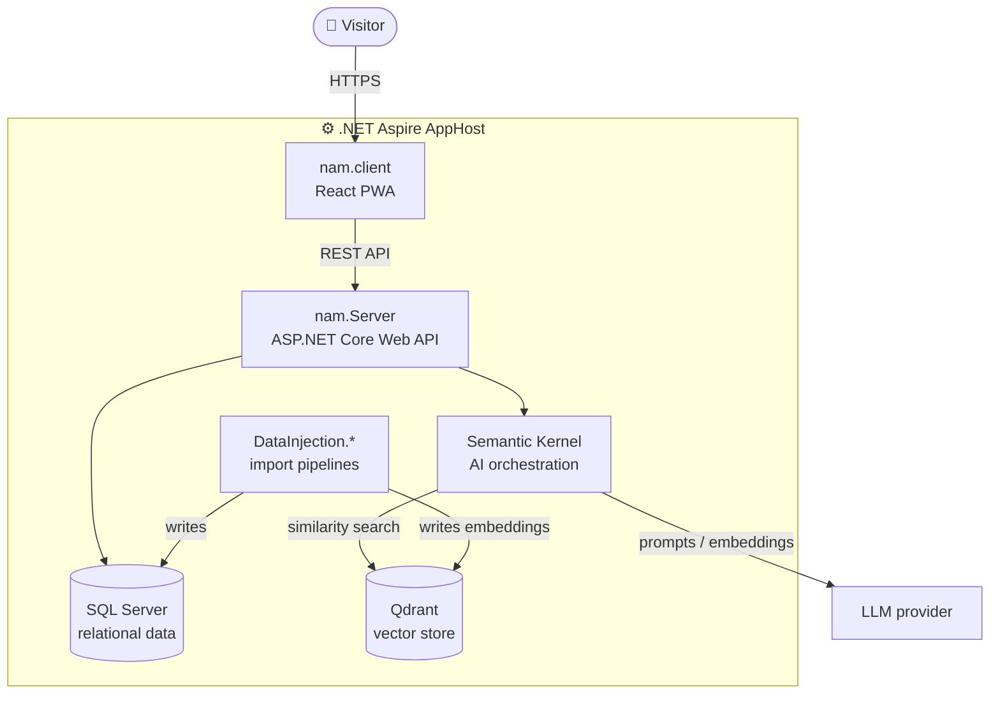

<div align="center">

# eppoi

**Discover Matelica like never before: personalized, intelligent, and always with you.**

[](https://dotnet.microsoft.com/download/dotnet/9.0)
[](https://learn.microsoft.com/en-us/dotnet/aspire/)
[](https://react.dev/)
[](#install-the-pwa)
[](https://www.docker.com/)
[](LICENSE)

</div>

**eppoi** is a Progressive Web App (PWA) that transforms the tourism experience in the city of **Matelica**. Using Artificial Intelligence, it offers personalized itinerary recommendations and a virtual assistant that guides visitors through the city's cultural, gastronomic and scenic highlights.

> Project developed by the **NAM** group for the *Software Project Management* course (SPM 2025-2026), University of Camerino.

---

## Table of Contents

- [Why eppoi](#why-eppoi)
- [Features](#features)
- [Architecture](#architecture)
- [Technology Stack](#technology-stack)
- [Getting Started](#getting-started)
- [Usage](#usage)
- [Project Structure](#project-structure)
- [Testing](#testing)
- [Contributing](#contributing)
- [License](#license)
- [Authors](#authors)

---

## Why eppoi

Matelica has a rich history, but finding the right experience can be overwhelming. Whether a visitor is looking for a Verdicchio wine tasting, a historical tour of Palazzo Ottoni or a hidden nature trail, **eppoi** learns their preferences and suggests the perfect activity.

## Features

| | Feature | Description |
|---|---|---|
| 📱 | **Progressive Web App** | Installable from the browser on Android, iOS and desktop. Fast, with offline support. |
| 🤖 | **AI Assistant** | Conversational interface that answers questions about Matelica: opening hours, local food, legends and more. |
| 🧭 | **Personalized Recommendations** | Suggests itineraries and events based on the interests collected during onboarding. |
| ☁️ | **Cloud-native backend** | Built on .NET Aspire for resilience, observability and scalability. |

## Architecture

The solution is a distributed system orchestrated by **.NET Aspire**: the `AppHost` project starts the backend, the frontend and all required containers (databases, vector store) with a single command.



## Technology Stack

| Layer | Technology |
|---|---|
| Orchestration | [.NET Aspire](https://learn.microsoft.com/en-us/dotnet/aspire/) |
| Backend | C# / .NET 9 |
| Frontend (PWA) | [React](https://react.dev/) |
| AI integration | [Semantic Kernel](https://learn.microsoft.com/en-us/semantic-kernel/) |
| Databases | [SQL Server](https://www.microsoft.com/sql-server) (relational) and [Qdrant](https://qdrant.tech/) (vector database) |
| Observability | OpenTelemetry (built into Aspire) |

## Getting Started

### Prerequisites

- [.NET 9.0 SDK](https://dotnet.microsoft.com/download/dotnet/9.0) or higher
- [Docker Desktop](https://www.docker.com/) (running, needed for Aspire containers)
- [Node.js](https://nodejs.org/) (LTS) for the frontend

### Installation

1. **Clone the repository**

   ```bash
   git clone https://github.com/SPM-25-26/NAM.git
   cd NAM
   ```

2. **Configure environment variables**

   Each service has a `.env.example` file. Copy it to `.env` and fill in the required values (API keys, connection strings, etc.).

   ```bash
   cp nam.Server/.env.example nam.Server/.env
   # repeat for every project that contains a .env.example
   ```

   On Windows (PowerShell): `Copy-Item nam.Server/.env.example nam.Server/.env`

   > ⚠️ Never commit `.env` files or real secrets.

3. **Trust the HTTPS development certificate**

   ```bash
   dotnet dev-certs https --trust
   ```

4. **Run the application**

   ```bash
   dotnet run --project nam/nam.AppHost
   ```

5. **Open the Aspire Dashboard**

   The console prints the dashboard URL (usually `https://localhost:17149`). From there you can inspect logs, traces and metrics, and open the PWA endpoint.

### Troubleshooting

| Problem | Solution |
|---|---|
| Containers don't start | Make sure Docker Desktop is running. |
| HTTPS certificate warning | Re-run `dotnet dev-certs https --trust`. |
| Service fails at startup | Check that every `.env` file is present and complete. |

## Usage

1. **Onboarding:** complete the initial preference survey so the AI can learn your interests.
2. **Ask the assistant:** open the chat and ask, for example, *"Where can I eat traditional Vincisgrassi?"*
3. **Explore recommendations:** browse the suggested itineraries and events.

### Install the PWA

- **Android:** open the browser menu (⋮) → *Add to Home screen*.
- **iOS:** tap *Share* → *Add to Home Screen*.
- **Desktop:** click the install icon in the address bar.

## Project Structure

```
NAM/
├── nam/                    # Aspire solution projects (AppHost, ServiceDefaults)
├── nam.Server/             # Backend Web API
├── nam.client/             # Frontend PWA
├── Domain/                 # Domain entities and business logic
├── Infrastructure/         # Data access and external services
├── DataInjection.Core/     # Shared logic for data import
├── DataInjection.SQL/      # Import pipeline for the relational database
├── Datainjection.Qdrant/   # Import pipeline for the Qdrant vector store
├── ServerTests/            # Backend tests
└── nam.sln                 # Visual Studio solution
```

## Testing

```bash
dotnet test nam.sln
```

## Contributing

Contributions are welcome!

1. **Fork** the repository.
2. Create a feature branch: `git checkout -b feature/amazing-feature`
3. Commit your changes: `git commit -m "Add amazing feature"`
4. Push the branch: `git push origin feature/amazing-feature`
5. Open a **Pull Request**.

Please follow the project's coding conventions and make sure the tests pass before opening a PR.

## License

Distributed under the **MIT License**. See the [LICENSE](LICENSE) file for details.

## Authors

| Name | Role | GitHub |
|---|---|---|
| Nicol Buratti | Backend | [@nicol-buratti](https://github.com/nicol-buratti) |
| Antonio Marseglia | Backend / Frontend | [@AntoMars14](https://github.com/AntoMars14) |
| Matteo Brachetta | Frontend | [@BrachettaMatteo](https://github.com/BrachettaMatteo) |

**SPM 2025-2026** · University of Camerino
